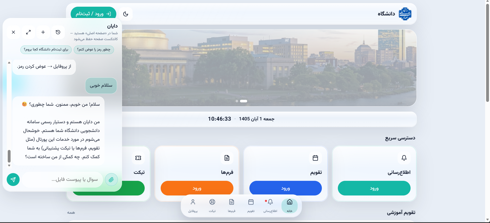
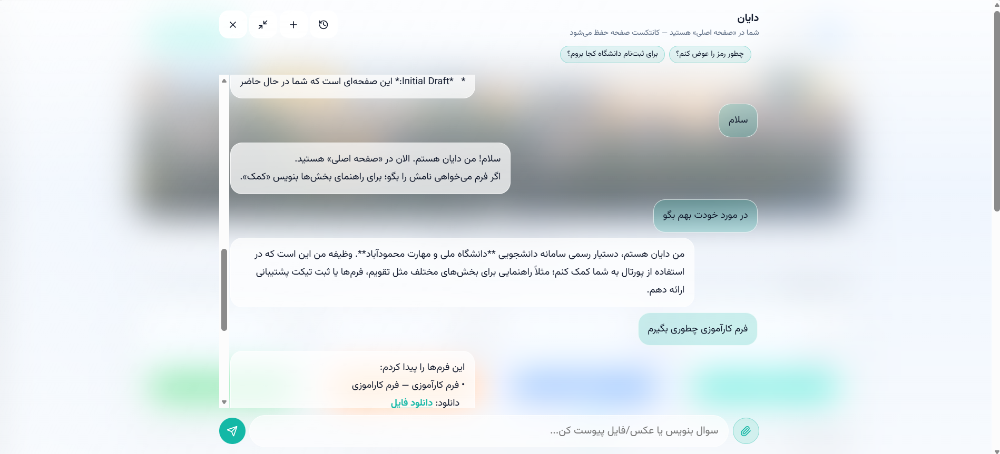
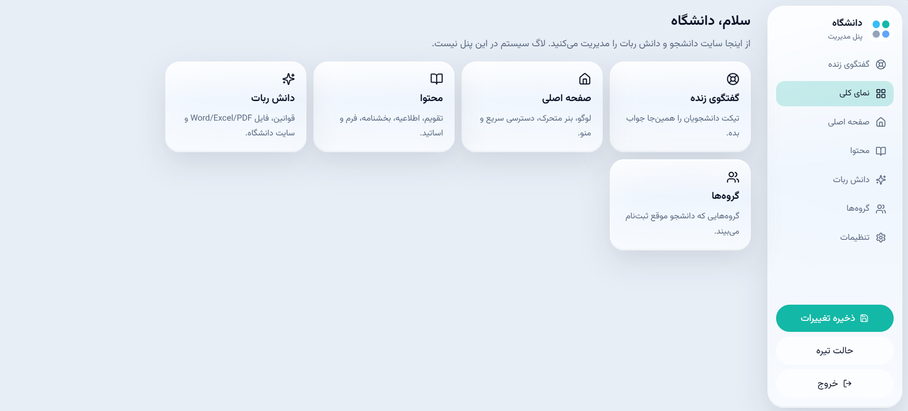
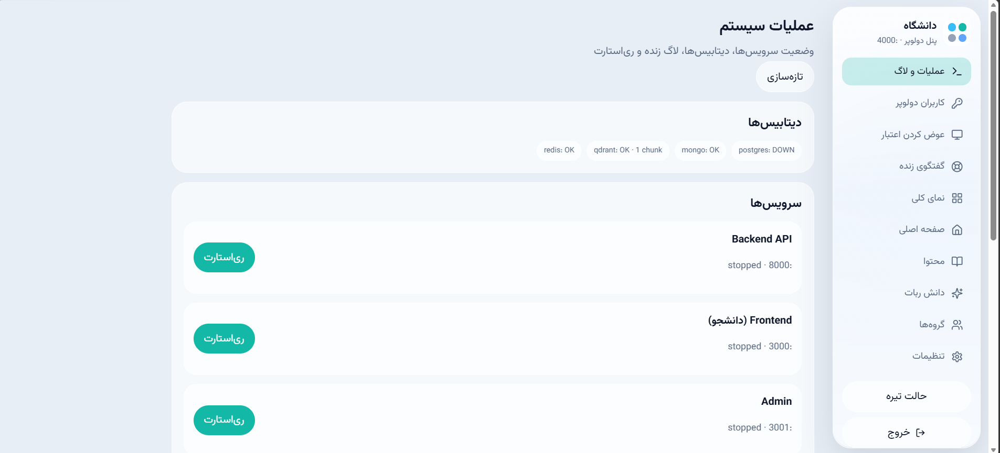

<div align="center">

# 🎓 دایان

دستیار هوشمند دانشجویی با چت مبتنی بر FAQ، مدل زبانی و RAG

<p>
  
  
  
  
</p>

<p>
  
  
  
  
</p>

<p>
  
  
  
</p>

<p>
  
  
</p>

</div>

---

## 🖼 تصاویر

<div align="center">

| ورود دانشجو | چت هوشمند |
|:-----------:|:---------:|
|  |  |

| پنل ادمین | پنل دولوپر |
|:---------:|:----------:|
|  |  |

</div>

---

## 🌐 آدرس‌ها

| سرویس | آدرس |
|--------|------|
| دانشجو | http://localhost:3000 |
| ادمین | http://localhost:3001 |
| دولوپر | http://localhost:4000 |
| API / Docs | http://127.0.0.1:8000 · http://127.0.0.1:8000/docs |
| Temporal UI | http://localhost:8080 |
| Health | http://127.0.0.1:8000/api/health |

---

## 🚀 اجرا با یک دستور (همه‌چیز با Docker)

```bash
copy .env.example .env
# مقدار JWT_SECRET را در فایل .env به یک رشته‌ی تصادفی و بلند تغییر بده
# MODEL_URL برای LM Studio روی ویندوز: http://host.docker.internal:1234

docker compose up -d --build
```

Temporal (ایندکس دانش) اختیاری است، چون ایمیجش سنگین است:

```bash
docker compose --profile temporal up -d
```

یا بدون پروفایل، با Temporal CLI روی سیستم خودت:

```powershell
tools\temporal-cli\temporal.exe server start-dev --ip 127.0.0.1 --port 7233 --ui-port 8080
```

صبر کن تا سرویس‌ها healthy شوند، بعد بررسی کن:

```bash
docker compose ps
curl http://127.0.0.1:8000/api/health
```

### توقف و لاگ

```bash
docker compose down            # توقف سرویس‌ها
docker compose logs -f api     # مشاهده‌ی لاگ API
```

> ⚠️ دستور `docker compose down -v` همه‌ی volumeها از جمله دیتابیس را پاک می‌کند. فقط وقتی می‌خواهی همه‌چیز از صفر ساخته شود از آن استفاده کن.

---

## 🧪 اجرا بدون Docker برای اپ‌ها (فقط دیتابیس‌ها در Docker)

```powershell
docker compose up -d postgres mongo redis qdrant

# Temporal محلی (اگر ایمیج Temporal کشیده نشد)
tools\temporal-cli\temporal.exe server start-dev --ip 127.0.0.1 --port 7233 --ui-port 8080

copy .env.example .env
python -m venv .venv
.venv\Scripts\activate
pip install -r requirements.txt
```

**ترمینال ۱ — API**

```powershell
$env:REDIS_URL="redis://127.0.0.1:6379/0"
$env:QDRANT_URL="http://127.0.0.1:6333"
$env:TEMPORAL_HOST="127.0.0.1:7233"
python -m uvicorn backend.main:app --host 127.0.0.1 --port 8000
```

**ترمینال ۲ — Temporal worker**

```powershell
python -m temporal.worker
```

**ترمینال ۳ تا ۵ — رابط‌های کاربری**

```powershell
cd frontend; npm install; npm run dev
cd admin; npm install; npm run dev
cd developer; npm install; npm run dev
```

---

## 🔑 اولین ورود

| پنل | راهنما |
|------|--------|
| **ادمین** (`:3001`) | اگر ادمینی وجود نداشت، فرم ساخت ادمین اول نمایش داده می‌شود؛ بعد از آن رمز را از تنظیمات عوض کن |
| **دولوپر** (`:4000`) | یک اکانت پیش‌فرض ساخته می‌شود؛ بعد از ورود اول، نام کاربری و رمز را عوض کن و سپس کاربر اضافه کن |
| **دانشجو** (`:3000/login`) | ثبت‌نام کن، یا از حساب‌های seed موجود در پروژه استفاده کن |

---

## ✨ امکانات

- چت با FAQ / مدل زبانی / RAG (امبد + چانک + Qdrant)
- Redis برای rate-limit
- Temporal برای ایندکس دانش (chunk → embed → upsert)
- تغییر رمز دانشجو و ادمین
- پنل دولوپر: لاگ، ری‌استارت و امکانات ادمین
- تور ورود اول برای دانشجو، چت با تاریخچه و حالت تمام‌صفحه

---

## 🔒 امنیت قبل از Production

- `APP_ENV=production` و `DEBUG=false`
- `JWT_SECRET` تصادفی و بلند
- رمز Postgres (و بقیه‌ی دیتابیس‌ها) را عوض کن
- CORS فقط برای دامنه‌ی واقعی باز باشد
- HTTPS پشت Nginx یا Caddy
- بکاپ از Postgres و از volume با نام `dayan_app_data`
- فایل `.env` را هرگز در گیت commit نکن